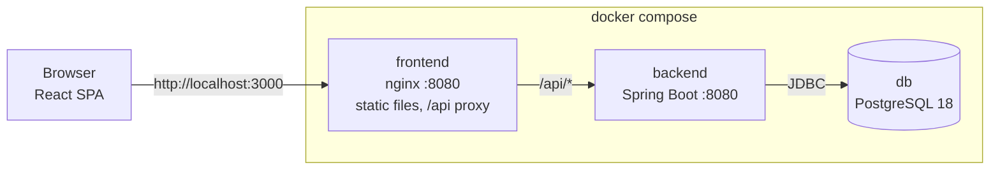
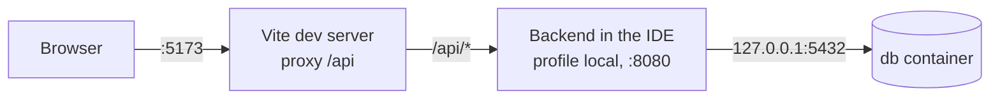
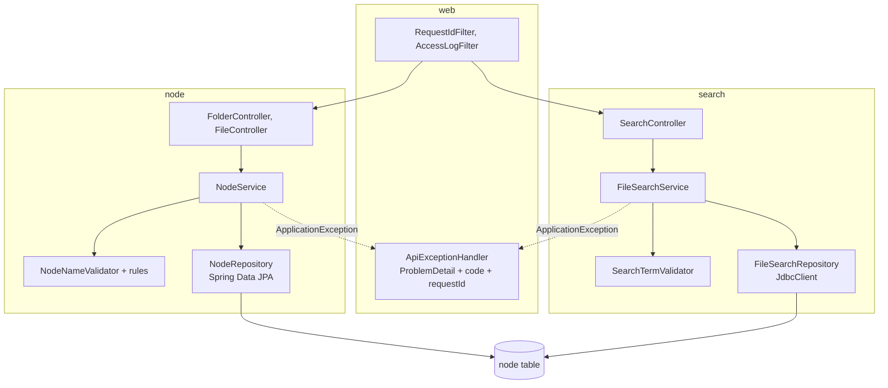
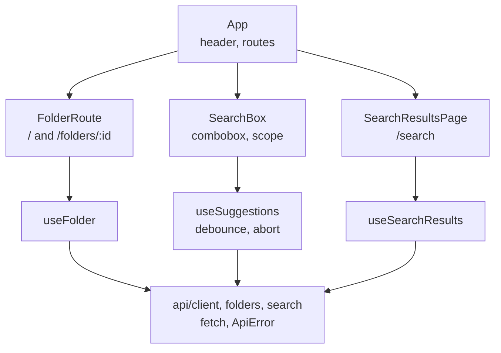

# Architecture

## Runtime

With Docker Compose the browser talks only to nginx. nginx serves the built React app and forwards `/api/` to the
backend, so the UI and the API share one origin and no CORS configuration is needed. Only nginx and the database
publish ports, and both bind to `127.0.0.1`.

During development the same split runs on the host: the Vite dev server on `:5173` proxies `/api` to the backend
started from the IDE on `:8080`, and only the database runs in Docker (`docker compose up -d db`).

## Backend

Packages are split by feature (`node`, `search`, `ping`) and layered inside each feature. Shared building blocks
live in `common`, and HTTP concerns that apply to every request live in `web`.

- Writes and folder listings go through JPA, because they work with whole entities and benefit from auditing and
  optimistic locking.
- Search reads only the columns it needs with hand-written SQL through `JdbcClient`, so the query matches the
  partial index exactly and `EXPLAIN` shows what runs.
- Every error leaves through one handler, so every 4xx has the same shape and a stable `code`.

## Frontend

State that the user can share or bookmark (the open folder, the search) lives in the URL. Everything else is local
component state; there is no global store.
