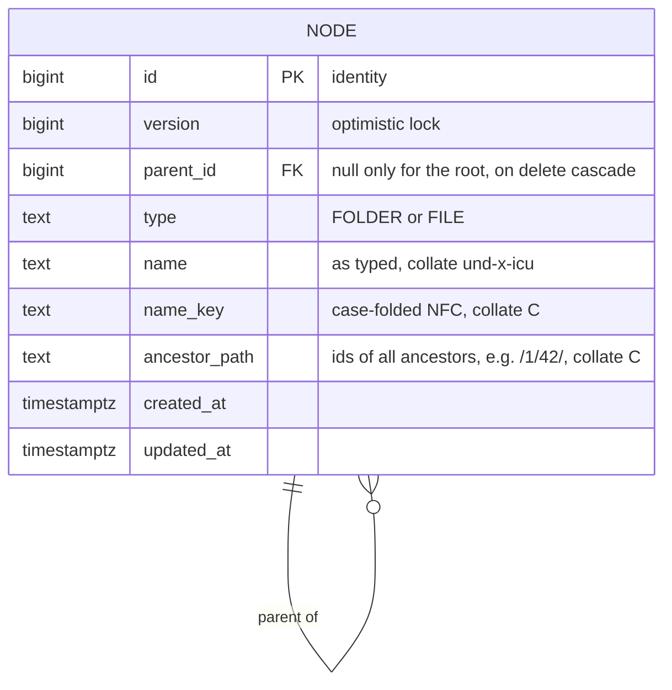

# Data model

Folders and files live in one table. Each row points to its parent folder, and also stores the ids of all its
ancestors as a path. The path never changes, because nodes cannot be moved or renamed.

## Example

| id | parent_id | type | name | name_key | ancestor_path |
|---|---|---|---|---|---|
| 1 | null | FOLDER | Home | home | `/` |
| 42 | 1 | FOLDER | Docs | docs | `/1/` |
| 43 | 42 | FOLDER | Work | work | `/1/42/` |
| 44 | 43 | FILE | Report.pdf | report.pdf | `/1/42/43/` |

## Constraints

| Constraint | Rule | Why |
|---|---|---|
| `fk_node_parent` | `parent_id` references `node(id)` `on delete cascade` | Deleting a folder removes its whole subtree in one statement, inside the database. |
| `uq_node_parent_name` | unique `(parent_id, name_key)` | Names are unique in a folder regardless of letter case, also between a file and a folder. |
| `uq_node_single_root` | unique index on `(parent_id is null)` where `parent_id is null` | There is exactly one root. |
| `ck_node_type` | `type in ('FOLDER', 'FILE')` | Only two kinds of node. |
| `ck_node_root_is_folder` | `parent_id is not null or type = 'FOLDER'` | The root is a folder. |
| `ck_node_name_length` | 1 to 255 characters | Same limit as common file systems. |

## Indexes

| Index | Columns | Serves |
|---|---|---|
| `ix_node_children` | `(parent_id, type, name)` | Listing a folder: folders first, then files, by name, with a keyset cursor on `(type, name)`. |
| `ix_node_file_search` | `(name_key, ancestor_path) where type = 'FILE'` | Exact-name search (equality on `name_key`, range on `ancestor_path` for a subtree) and suggestions (range on `name_key`). Folders are never searched, so they are left out of the index. |

`name_key` and `ancestor_path` use the `C` collation, so they compare byte by byte. That makes a prefix a plain
range: files below folder 42 are the rows with `ancestor_path >= '/1/42/'` and `< '/1/420'`, and names starting
with `rep` are the rows with `name_key >= 'rep'` and `< 'rep' || U+10FFFF`. Both are index range scans without a
sort step.
